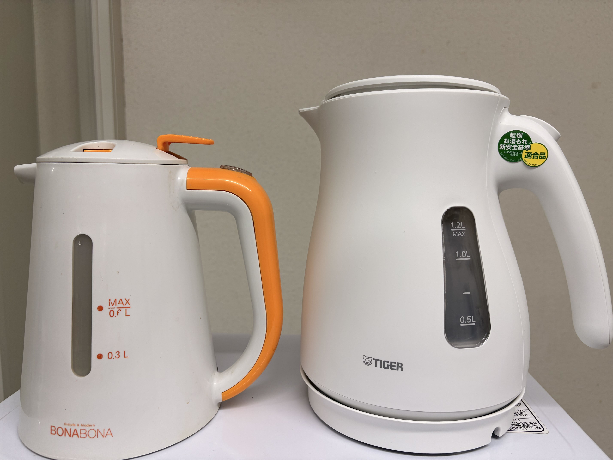
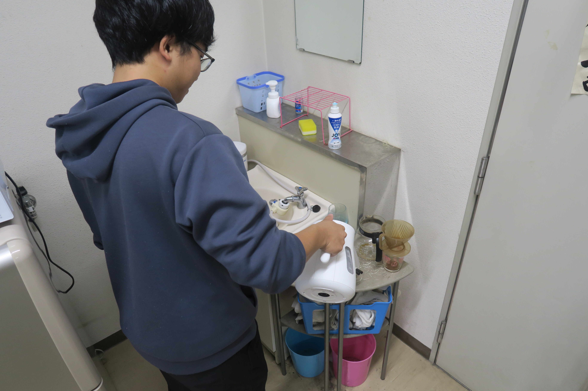

+++
date = '2026-11-13T16:24:26+09:00'
draft = false
title = 'Kettle: Born Again'
showAuthor = true
authors = ['abo-n']
+++
こんにちは！
B4 の阿保です．

今回は，研究室に新しいケトルが届いたことについて書きます．

## ケトルが壊れた
研究室では，日々の作業のお供としてコーヒーをいれて飲むことが多く，ケトルは欠かせない存在です．
しかし，2週間ほど前にそのケトルが壊れてしまいました．
それ以来，研究室でコーヒーをいれることができず，とても不便な日々が続いていました．

その間は，隣の研究室からケトルを何度かお借りしてしのいでいました．
快く貸してくださり，本当にありがとうございました．

## 新しいケトル
そんな中，新しいケトルがついに届きました！
下の写真の左がこれまで使っていたケトル，右が新しく届いたケトルです．

これまでのケトルは容量が 0.6 L だったのに対し，新しいケトルは 1.2 L と一回り大きくなりました．
以前は容量が足りず，コーヒーポットを満杯にするには何度かお湯を沸かす必要がありました．
新しいケトルでは一度の湯沸かしでコーヒーポット満杯分のお湯を沸かせるようになったので，複数人分のコーヒーもまとめていれられます．

さっそく先輩も新しいケトルを使っていました．

## おわりに
ケトルが無い期間を経て，改めてその大切さを実感しました．
新しいケトルとともに，研究室のコーヒーライフがさらに捗りそうです．
